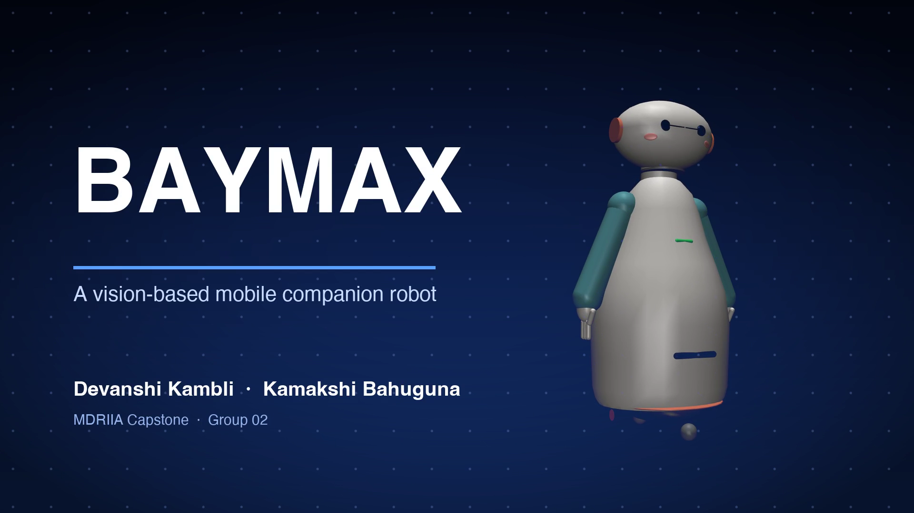

# MDRIIA Group 02: AI Companion Robot for Remote Elderly Supervision and Fall Emergency Response
**Course:** Modern Day Robotics and Its Industrial Applications (MDRIIA - Course Code: 702CO0E012)  
**Academic Term:** Academic Year 2026–2027 | Semester VI (B.Tech CSBS)  
**Institution:** SVKM's NMIMS MPSTME, Mumbai  

---

## 1. Authorized Research Title & Problem Statement

> "How can a vision-based mobile companion robot in MuJoCo integrate MediaPipe fall-detection kinematics to reduce emergency dispatch latency within the critical 6-minute cardiac arrest survival window for elderly individuals living alone?"

### Core Engineering Focus
* **Physics & Kinematics:** Google DeepMind MuJoCo multi-body dynamic physics simulation (`models/elderly_companion_base.xml`).
* **Autonomous Control:** Closed-loop Python control architecture  (`src/control/behavior.py` and `src/vision/fall_detector.py`).
* **Technoeconomic Evaluation:** Dimensionless CSBS operational economics and return on investment model (`analytics/healthcare_economics.py`).
* **Empirical Validation:** Reproducible benchmark trials and statistical hypothesis testing (`outputs/experiments/<split>/analysis`, produced by `src/experiments/analyze.py` from the seeded runs).

---

> [!NOTE]
> ### The Devil's Advocate: Reality Check & Theoretical Roast
> *"An autonomous mobile companion equipped with pan-tilt MediaPipe vision to detect sudden falls within the 6-minute golden window, which will inevitably trigger a code-red 911 emergency dispatch because grandpa dropped his TV remote and decided to take an afternoon nap on the living room rug."*

---

## 2. Student Engineering Team Matrix

| Roll No | SAP ID | Student Name | Technical Role | Assigned Git Branch | Core Viva Defense Area |
| :--- | :--- | :--- | :--- | :--- | :--- |
| `E007` | `70362400022` | **Kamakshi Bahuguna** | Computer Vision, Pose Kinematics & Edge Inference Specialist | `feat/e007-vision-pose-kinematics` | MediaPipe skeletal landmark tracking, bounding-box aspect ratio inversion, vertical centroid velocity thresholding, and confusion matrix validation. |
| `B029` | `70362400037` | **Devanshi Sachin Kambli** | MuJoCo Physics, Domestic Navigation & Healthcare Economics Lead | `feat/b029-mujoco-physics-navigation` | Differential mobile base physics, pan-tilt mast observation angles, post-fall approach trajectory, and 'long lie' clinical cost model. |


### Student Engineering Commendation & Acknowledgments
SVKM's NMIMS MPSTME conveys sincere appreciation and heartfelt gratitude to **Kamakshi Bahuguna (E007)** and **Devanshi Sachin Kambli (B029)** for their disciplined commitment, late-night debugging, and technical craftsmanship throughout Semester VI. Your rigorous work in DeepMind MuJoCo physics modeling, closed-loop telemetry instrumentation, and Computer Science & Business Systems (CSBS) technoeconomic modeling exemplifies the highest standards of undergraduate engineering inquiry.

> *"Scientists discover the world that exists; engineers create the world that never was."*  
> — **Theodore von Kármán**

> *"There is no substitute for hard work. Genius is one percent inspiration and ninety-nine percent perspiration."*  
> — **Thomas A. Edison**

---

## 3. Foundational Literature Benchmarks (Strict 2 Seminal : 4 Recent Ratio)

The research project is theoretically anchored on six foundational peer-reviewed publications validated against global bibliographic databases.

| # | Author (Year) | Type | Paper Title | Venue / Indexing | Active DOI Link | Primary Extracted Formulation | Student Lead |
| :--- | :--- | :--- | :--- | :--- | :--- | :--- | :--- |
| 1 | **Wang & Deng (2024)** | Recent | *Enhancing elderly care: Efficient and reliable real-time fall detection algorithm* | Digital Health | [https://doi.org/10.1177/20552076241233690](https://doi.org/10.1177/20552076241233690) | `Aspect ratio $AR = \frac{w_b}{h_b}$; vertical...` | Kamakshi Bahuguna (E007) |
| 2 | **Kothari & Chakurkar (2025)** | Recent | *Towards safer environments: A YOLO and MediaPipe-based human fall detection system* | MethodsX | [https://doi.org/10.1016/j.mex.2025.103623](https://doi.org/10.1016/j.mex.2025.103623) | `Keypoint angle $\theta = \arccos\left(\frac{\...` | Kamakshi Bahuguna (E007) |
| 3 | **Romero-Garces et al. (2022)** | Recent | *CLARA: Building a Socially Assistive Robot to Interact with Elderly People* | Designs | [https://doi.org/10.3390/designs6060125](https://doi.org/10.3390/designs6060125) | `Mast center-of-mass height $h_{\text{mast}} \...` | Devanshi Sachin Kambli (B029) |
| 4 | **Ding & Wang (2020)** | Seminal | *A WiFi-Based Smart Home Fall Detection System Using Recurrent Neural Network* | IEEE Transactions on Consumer Electronics | [https://doi.org/10.1109/TCE.2020.3021398](https://doi.org/10.1109/TCE.2020.3021398) | `CSI phase difference $\Delta \phi = \arg(H_i)...` | Devanshi Sachin Kambli (B029) |
| 5 | **Kubitza et al. (2022)** | Recent | *Therapy options for those affected by a long lie after a fall: a scoping review* | BMC Geriatrics | [https://doi.org/10.1186/s12877-022-03258-2](https://doi.org/10.1186/s12877-022-03258-2) | `Hospital stay duration $D_{\text{stay}} = 18....` | Devanshi Sachin Kambli (B029) |
| 6 | **Chen et al. (2021)** | Seminal | *Vision-Based Elderly Fall Detection Algorithm for Mobile Robot* | IEEE International Conference on Electronics Technology (ICET) | [https://doi.org/10.1109/ICET51757.2021.9450950](https://doi.org/10.1109/ICET51757.2021.9450950) | `Major-to-minor axis ratio $\lambda = \frac{a}...` | Kamakshi Bahuguna (E007) & Devanshi Sachin Kambli (B029) |

For the exhaustive literature analysis, mathematical derivations, and viva defense questions, refer to:
* [`docs/LITERATURE_REVIEW_AND_FOUNDATIONAL_PAPERS.md`](docs/LITERATURE_REVIEW_AND_FOUNDATIONAL_PAPERS.md)
* [`docs/RESEARCH_PAPER_MANUSCRIPT_BLUEPRINT.md`](docs/RESEARCH_PAPER_MANUSCRIPT_BLUEPRINT.md)

---

## 4. Project Demonstration & Academic Showcase (LinkedIn)

[](https://www.linkedin.com/)

* **Video Demonstration:** [Watch 60-Second Walkthrough on LinkedIn](https://www.linkedin.com/) *(Click thumbnail above to open LinkedIn post)*
* **Student Presenters:** **Kamakshi Bahuguna (E007)**, **Devanshi Sachin Kambli (B029)**
* **Academic Institutional Tags:** SVKM's NMIMS MPSTME | Academic Directorate | Industry 4.0 Robotics
* **Submission Protocol:** Record a 60–90 second demonstration of your MuJoCo simulation and telemetry. Publish on LinkedIn tagging MPSTME, Dean, and Course Faculty. Insert your live post URL in `docs/TEAM_ROSTER.json` under `"linkedin_url"`, and submit a pull request to update this project dossier and the cohort dashboard.

---

## 5. Repository Directory Architecture

```
.
|-- README.md                                          <- Front-page research charter, student roster & literature
|-- RESEARCH_AND_IMPLEMENTATION_GUIDE.md               <- Comprehensive technical engineering guide
|-- docs/
|   |-- TEAM_ROSTER.json                               <- Machine-readable team configuration
|   |-- LITERATURE_REVIEW_AND_FOUNDATIONAL_PAPERS.md   <- Exhaustive literature dossier (6 verified papers)
|   |-- RESEARCH_PAPER_MANUSCRIPT_BLUEPRINT.md         <- 4-page IEEE conference manuscript blueprint
|   `-- figures/
|       |-- figure1_system_architecture.png            <- 300 DPI system architecture diagram
|       |-- (paper figures: see paper/ and results/small_robot_test/figures)
|-- models/
|   |-- .gitkeep
|   |-- domestic_environment.xml                       <- Apartment MJCF scene (generated)
|   `-- elderly_companion_base.xml                                    <- MuJoCo MJCF simulation model
|-- src/
|   |-- test_env.py                                    <- Physics validation & environment tester
|   |-- tools/open_scene.py                            <- Viewer for models/domestic_environment.xml
|   `-- (control: src/control/behavior.py, vision: src/vision/fall_detector.py)                                      <- follow, search, approach, check-in, dispatch
`-- analytics/
    |-- .gitkeep
    |-- healthcare_economics.py                                         <- CSBS dimensionless technoeconomic model
    `-- (results are generated into outputs/, not committed)                                 
```

---

## 5. Pedagogical Boundaries: Guidance vs Student Ownership

To ensure academic rigor and authentic student learning, this repository enforces strict boundaries between scaffolding and student deliverables:

* **Provided by Course Scaffolding:**
  * Validated physical model architecture in MuJoCo MJCF (`models/elderly_companion_base.xml`).
  * Verification toolchain and smoke test script (`src/test_env.py`).
  * Literature foundation, mathematical formulations, and conference paper blueprint (`docs/`).
  * Dimensionless technoeconomic framework (`analytics/healthcare_economics.py`).
* **Student Technical Deliverables (Required for Evaluation):**
  * Implement and tune the control algorithm in `src/control/behavior.py` and `src/vision/fall_detector.py` .
  * Run physics simulation trials to collect and expand empirical data in `outputs/experiments/<split>/analysis` (generated by `src/experiments/analyze.py` from the seeded runs)`.
  * Paper figures come from the seeded runs: `python src/experiments/analyze.py <split>` (figures in outputs/experiments/<split>/analysis/figures; the paper's copies are in paper/).
  * The final 4-page paper is `paper/paper.tex` (outline and verified claims: `docs/RESEARCH_PAPER_MANUSCRIPT_BLUEPRINT.md`) and defend individual Git commits during the oral viva.

---

### Apartment scene (Devanshi's environment work)

`models/domestic_environment.xml` is a 7 x 6 m one-bedroom flat, generated by `python src/sim/build_apartment.py` from the single layout file `src/sim/apartment_layout.py`:

- **Rooms:** open-plan living and dining (hardwood, friction 0.42), hallway (laminate, 0.50), bedroom (low-pile carpet, 0.68).
- **Doorways:** 0.90 m (living room) and 0.85 m (bedroom), as in the guide.
- **Furniture:** sofa, coffee table, TV, bookshelf, lamp, dining table with four free chairs, kitchen counter, bed (top at 0.50 m, for the lying-down activity), wardrobe, nightstands, plants.
- **Trip hazard:** a curled rug edge with a pair of slippers, which is why she trips.
- **Moving obstacle:** a robot vacuum looping around the dining area (`src/sim/dynamic_obstacles.py`; speed settable per trial).
- **Cameras:** `overview` (cut-away dollhouse view), `top`, and `static_cam` (ceiling camera for the static-sensor baseline).
- **Walls:** the default view is cut-away (walls drawn 0.8 m high). Full-height walls are geom group 2 (`--full-walls`). Collision geometry is always full height.

```bash
mjpython src/tools/open_scene.py            # empty apartment (--human runs the walk-and-fall demo)
python tests/test_apartment.py              # door widths, path clearance, settling, friction zones
```

### Human subject (female SMPL-X avatar)

`models/human_subject.xml` and `models/scene_with_human.xml` are generated from the Habitat Humanoids `female_1` skeleton and textured skin (`python src/sim/build_human_mjcf.py`). She gets up beside the bed, walks through the hallway into the living room and trips on the rug edge (`python src/sim/walk_and_fall.py`; add `--gif outputs/demo.gif` for a GIF, `--skeleton` for the 33-landmark sketch view, or `--view` with `mjpython`). Asset licence and attribution: `models/human/README.md`.

### Companion robot, fall detection and family alert

A small EMO-style robot (1.2 kg, 17.5 cm tall: head with a front screen and camera, pan-tilt neck, skateboard-style deck, two driven wheels and two passive casters; sketch in `outputs/robot_kinematic_sketch.png`, dimensions in `src/robot/robot_spec.py`) watches the flat from its dock. When she falls it detects the collapse with its own camera, waits for her to settle, drives to about 1 m from her, asks "Are you okay?", and if she does not respond sends the family a message with a face-blurred snapshot and calls the ambulance (all simulated; nothing real is sent).

Two scenarios: `--scenario follow` (default; the robot starts in the bedroom and follows her around the flat, loses sight of her at doors, searches, finds her on the floor) and `--scenario watch` (the robot waits on its dock and sees the fall side-on).

```bash
python src/sim/build_all.py                      # regenerate apartment, woman and robot models
MUJOCO_GL=glfw python src/sim/run_demo.py        # full demo: video, telemetry, alert log in outputs/demo_run/
MUJOCO_GL=glfw python src/sim/run_demo.py --scenario watch
mjpython src/sim/run_demo.py --view              # the same, live (macOS), events printed as they happen
python tests/test_apartment.py && python tests/test_navigation.py && python tests/test_fall_detector.py
MUJOCO_GL=glfw python tests/test_robot.py && MUJOCO_GL=glfw python tests/test_perception.py
```

| Part | Where |
|---|---|
| Robot model, motors, sensors | `src/sim/build_robot_mjcf.py`, `src/robot/` |
| Camera + MediaPipe to 3D body points (on board, uses only the robot's own sensors) | `src/vision/person_observer.py`, `blazepose_tracker.py` |
| Fall detector (watches movement over time) | `src/vision/fall_detector.py` |
| Map, route planning, path following, standoff | `src/control/navigation.py` |
| State estimation (odometry + range-scan matching against the map) | `src/control/localization.py` |
| Behaviour: watch, suspect, approach, check in, alert | `src/control/behavior.py` |
| Family messages, ambulance call, privacy accounting | `src/control/dispatch.py`, `config/family_contacts.json` |

The MediaPipe pose model (5.8 MB) is not stored in git; the download command is in `src/vision/blazepose_tracker.py`.


---

## 6. Sprint 0 Onboarding & Physics Environment Verification

Verify your local Python and MuJoCo simulation environment:

```powershell
# Step 1: Clone repository and navigate to group directory
git clone <repository_url>
cd <repository_root>/Group_02_Kamakshi_Devanshi

# Step 2: Checkout your individual feature branch
# Example for lead student:
git checkout -b feat/e007-vision-pose-kinematics

# Step 3: Run environment smoke test
python src/test_env.py

# Step 4: Verify 300 DPI publication figures
python src/experiments/analyze.py test
```


## Experiment set (simulation): robot vs fixed camera, falls and daily activities

Falls (trip, slip, syncope, cardiac collapse with scripted pre-collapse behaviour) and daily activities (abrupt and slow sitting on a low
sofa, lying on the bed, tying shoelaces, dropping keys, sitting and lying on the floor) are generated from seeds; every trial is run with the
companion robot and with a fixed ceiling camera (same MediaPipe pipeline, same detector thresholds, no mobility). Floor friction, clutter,
obstacle speed, sensor noise, push disturbances and camera dropouts are randomised.

```bash
export MUJOCO_GL=glfw
python src/experiments/check_clips.py dev 40 1                       # record and sanity-check her motions
python src/experiments/run_experiments.py dev 40 1 --workers 5       # development split
python src/experiments/fit_detector.py dev                           # fit the fall-detector thresholds on dev only, freeze them
python src/experiments/run_experiments.py test 120 2 --workers 5 --cfg outputs/experiments/frozen_config.json
python src/experiments/analyze.py test                               # tables, statistics, figures -> outputs/experiments/test/analysis/
python tests/test_motions.py
```
All messages and calls are simulated. The medicine reminder (`src/sim/run_reminder_demo.py`) is a demo only and is not part of any measured result.


## Baymax, the family platform, the siren and the wide camera (demo features, not part of the measured experiments)

- **Baymax (src/agent):** a Strands agent with feelings (worry, alarm, joy, calm) that phrases everything the robot says and texts, so the family hears one consistent voice. Facts come from the simulator, the model only chooses the wording; answers are checked (facts present, no diagnosis, short) and the ambulance script is never rephrased. With `ANTHROPIC_API_KEY`, `OLLAMA_HOST` or AWS credentials it uses a real model; otherwise it runs on offline wording. Only text ever reaches a model, never video.
- **Family platform (family_app):** a local web page showing where she is, what she is doing, whether she took her tablet (and whether the robot SAW it), alerts, the siren and Baymax's feelings, and letting the family talk to her through Baymax, send a reminder, ask Baymax to check on her, tilt the camera, ask for a face-blurred picture (only if she agreed) and silence the siren. There is no video stream; you must sign in (per-person login); the server listens on this computer only.
- **Wide camera:** with `wide_view` the head camera tilts from -75 to +70 degrees (the guide's default is -45 to +30) and nods up and down while searching.
- **Siren:** when she has collapsed and does not answer, the robot sounds a loud two-tone alarm, calls for help out loud ("HELP! A woman has collapsed in the living room! Please come now and call 108!"), and texts the family and neighbour. A chest-clutch pattern just before the collapse makes it louder (100 instead of 95 dB at 1 m) and is mentioned in the texts. The robot never says she is having a heart attack.

```bash
export MUJOCO_GL=glfw
python src/sim/run_platform_demo.py --scenario medicine --agent     # then open http://127.0.0.1:8765 and sign in (rohan / rohan-demo, meera / meera-demo, iyer / iyer-demo)
python src/sim/run_platform_demo.py --scenario cardiac --agent --consent --sound
python src/agent/siren.py --play                                     # hear the siren, writes outputs/siren_demo.wav
python tests/test_agent.py && python tests/test_platform.py
```
