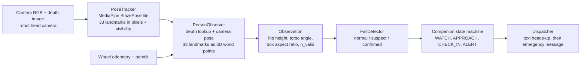

# Vision pipeline: from a camera image to a fall alert

Owner: Kamakshi Bahuguna (E007/07), vision and pose lead. Everything here is read from the code in `src/vision/` and `src/control/behavior.py`; file names are given so each claim can be checked. Numbers marked *(dev)* come from the 40-trial dev split only, never from the test split.

## 1. What the vision part has to do
The robot watches one person. From camera frames alone it must decide: did she fall, is she still down, or is this normal life (sitting, bending, lying on the bed)? Only a confirmed fall may wake the rest of the system (approach, check-in, alert). Everything the robot knows comes from its own sensors: camera, depth, wheel odometry and neck angles. Simulator ground truth is used only for logging and scoring.

## 2. Data flow



| Stage | File | Input | Output |
|---|---|---|---|
| 1 Pose model | `src/vision/blazepose_tracker.py` | one RGB frame | 33 landmarks (x, y in the image, visibility 0 to 1), or nothing if no person is found |
| 2 To 3D | `src/vision/person_observer.py` | landmarks + depth image + robot pose + neck angles | `Observation` with 33 world points (metres, room frame) |
| 3 Decide | `src/vision/fall_detector.py` | `Observation` every frame (or `None`) | state: `normal`, `suspect`, `confirmed` |
| 4 Act | `src/control/behavior.py` | detector state | approach her, ask "Are you okay?", alert the family |

## 3. Stage by stage

**Stage 1, finding the body.** `PoseTracker` runs the MediaPipe `pose_landmarker_lite` model on one frame at a time (one person, minimum confidence 0.3). If no body is found the frame gives `None`. The model file is not stored in git; the download command is in the file's docstring.

**Stage 2, from pixels to metres.** `PersonObserver.observe` uses only the pixel positions and visibility from stage 1. For each landmark it reads the depth image in a 5 x 5 window and takes the 10th percentile, meaning the nearest surface, so a landmark at the edge of her body does not pick up the wall behind her. A landmark whose depth is more than 1.2 m away from the median depth of the visible landmarks is moved to that median. A pinhole camera model then turns pixel plus depth into a point in camera space, and the camera's pose (from wheel odometry plus pan and tilt) places it in the room. A landmark counts as valid if it is inside the image, has visibility above 0.3 and has a sensible depth.

**What an `Observation` offers** (same file):
- `hip`: mean world position of the valid hip landmarks. Its height `z` is the main signal.
- `torso_pitch_deg()`: angle between the hip-to-shoulder line and vertical (0 is upright, 90 is horizontal).
- `aspect`: width divided by height of the OpenCV bounding box around her valid landmarks in the image.
- `n_valid`: how many landmarks are valid. The detector skips the box test when fewer than 12 are valid.

**Stage 3, the detector** (`FallDetector`, all thresholds in `FallConfig`). It watches how the body moves over time, not a single frame. Hip height is smoothed with a causal 2nd-order Butterworth low-pass filter (5 Hz cutoff, 30 Hz nominal frame rate).

| Transition | Rule (code defaults) |
|---|---|
| `normal` to `suspect` (impact) | in the last 1.2 s the hip was at least 0.60 m high and is now at most 0.35 m; the drop is at least 0.40 m; the peak descent speed over a 0.15 to 0.5 s stretch is at least 1.2 m/s; torso angle at least 50 degrees; the box is at least as wide as tall (aspect at least 1.0) and the aspect rises at least 1.0 per second (this box test is skipped if `n_valid` < 12) |
| `suspect` to `confirmed` | after 3.0 s the body is still low (hip at most 0.50 m) and still (the median hip position moved at most 0.25 m between the two halves of the last 2 s) |
| `suspect` to `normal` | she stands up again (hip at least 0.60 m), or she keeps moving while low for more than 8 s (treated as deliberate, for example floor exercise) |
| `normal` to `confirmed` directly (unwitnessed) | found low (hip at most 0.35 m) and horizontal (torso at least 50 degrees) and still for 5 s, without having seen the fall; recorded as `witnessed = False` |
| `confirmed` to `normal` | she stands up (hip at least 0.60 m) |

The guide's values on perfect data are 0.20 m, 1.8 m/s, 60 degrees and aspect 1.2. The code uses looser values because the camera-estimated 3D landmarks are noisier than ground truth (the docstring says about 17 cm off when she is lying). The thresholds were fitted on the dev split; the 120-trial test split stays frozen.

**Stage 4, what the robot does with the state** (`src/control/behavior.py`). `suspect` or `confirmed` takes the robot from watching or following to approaching her (stopping about 1.0 m away), then `CHECK_IN`: it asks "Are you okay?" and waits (10 s check-in, repeating the question after 5 s). If she moves or answers, the alarm is cancelled. If not, the family gets the emergency message. A text-only heads-up is sent when the detector reaches `confirmed`.

**What may leave the robot** (`docs/ALERT_SCHEMA.md`, `tests/test_alert_privacy.py`). Before the first alert nothing leaves it: frames are processed on board and discarded, and `bytes_off_board` stays 0. The heads-up has no picture. The emergency message carries a short structured payload (room, time, hip height, torso angle, whether the fall was witnessed) and at most one face-blurred snapshot, only with her consent. Raw video and the landmark stream are never sent.

## 4. Known limits, reported honestly
- **Simulation only so far.** All results come from the MuJoCo simulation. Real-video testing (Task 7) is still to do, so no claim is made about real people or real cameras.
- **Thresholds are not fragile *(dev)*.** Moving `ar_min` (0.6 to 1.8) or `pitch_min_deg` (30 to 80) one at a time barely changes the results on the robot camera: about 12 of 13 falls are detected and 16 of 20 activity streams stay free of false alarms (`docs/figures/threshold_sensitivity.png`). The flat curves also mean these two thresholds are not what decides the result. The dev set is small, so one trial moves a score by about 7 points.
- **Sofa false alarms *(dev)*.** The one sofa false alarm (`dev_020`) fired at 6.1 s while her true hip height was still 0.88 m. The detector saw about 0.05 m. Landmark visibility was high (about 0.95) on those frames, so low visibility is not the cause. She is often lost entirely near the sofa, and the bad heights appear after she is found again. A likely cause is the depth step: the "nearest surface in a 5 x 5 window" rule can pick up the sofa instead of her body, but this is a hypothesis, not a result (`docs/figures/sofa_false_alarm_visibility.png`).
- **Cardiac pre-collapse cues were dropped.** They flagged about half of normal trials (`docs/PRODROME_NEGATIVE_RESULT.md`), so they never trigger an alert.
- **Out of view.** If she is never in view after the event (it happens in several sofa trials), no threshold can detect the fall.

## 5. Viva question and answer sheet

**Q1. Walk me through the pipeline in one minute.**
A camera frame goes into MediaPipe BlazePose, which gives 33 body landmarks in pixels. The observer reads the depth image at each landmark and, using the robot's camera pose, turns them into 3D points in the room. From those I take hip height, torso angle and the bounding-box aspect ratio. The detector watches those over time: a fast drop to the floor with a horizontal torso is a suspected fall, and staying down and still for 3 s confirms it. Only then does the robot approach, ask if she is okay, and alert the family.

**Q2. Why not use a single frame?**
A person lying on a sofa or bending to tie shoelaces can look like a fall in one frame. Time separates them: a fall has a fast drop (at least 1.2 m/s here) and then stillness.

**Q3. Where does hip height come from?**
From pixel position plus depth plus the robot's own pose, not from BlazePose's own 3D output. So errors can come from the depth lookup or from the camera pose estimate, not only from the pose model.

**Q4. Why is depth the 10th percentile of a 5 x 5 window?**
To take the nearest surface, which is her body, instead of the wall behind her at the edge of her silhouette. The side effect is that anything closer than her, such as a sofa, can win instead.

**Q5. Why are your thresholds different from the guide's?**
The guide's values (0.20 m hip height, 1.8 m/s, 60 degrees, aspect 1.2) are for ground-truth data. Camera-estimated landmarks are noisier, so the code uses 0.35 m, 1.2 m/s, 50 degrees and aspect 1.0. They were fitted on the dev split.

**Q6. Why dev only? What about the test split?**
Fitting on the test split would make the final numbers look better than they are. The test split stays frozen so the reported result is honest. All my figures use the dev split only.

**Q7. What does your threshold sensitivity figure show?**
Moving the aspect-ratio or torso-angle threshold one at a time changes the results very little, so the detector is not over-tuned on those two. It also means those two thresholds are not what decides the result. I would sweep the descent speed and hip height thresholds next.

**Q8. What is the cause of the sofa false alarms?**
Not low landmark visibility. In `dev_020` the detector saw a hip height of about 0.05 m while the true height was 0.88 m, with visibility around 0.95. She is also often lost near the sofa. The likely cause is wrong depth near the sofa, but I have not proved it.

**Q9. What happens if the camera cannot see her at all?**
Nothing can be detected. The detector returns its last state and ignores a lying reading older than 2 s so a stale reading cannot linger. The robot then searches for her.

**Q10. How does the detector handle someone lying on the floor on purpose, such as exercise?**
If she keeps moving while low for more than 8 s the alarm is cancelled as deliberate low movement. If she lies still on the floor for 5 s without the fall being seen, it is confirmed as an unwitnessed event, and the robot's check-in decides whether she is fine.

**Q11. What leaves the robot, and when?**
Nothing before the first alert (`bytes_off_board` is 0, tested in `tests/test_alert_privacy.py`). The heads-up has text only. The emergency message has the structured facts and at most one face-blurred snapshot, only with consent.

**Q12. Why did you drop the cardiac cues?**
On the test split they flagged 51 of 105 non-cardiac trials (49%), which would flood the family with warnings, so they never trigger an alert. The result is reported as negative.

**Q13. What is the biggest weakness of the vision part?**
It has only been tested in simulation, and the dev set is small. Real-video testing with a consenting person is still to do.

**Q14. Change a threshold live. What do you do?**
Open `FallConfig` in `src/vision/fall_detector.py`, change one value (for example `min_peak_descent`), and re-run `python tests/test_fall_detector.py` or `python src/experiments/threshold_sensitivity.py dev`. Say before running what you expect to change and why.

## 6. Commands to know
```
python tests/test_fall_detector.py
python tests/test_perception.py
python tests/test_alert_privacy.py
python src/experiments/threshold_sensitivity.py dev        # needs outputs/experiments/dev
python src/experiments/sofa_false_alarm_visibility.py dev  # needs outputs/experiments/dev
```
